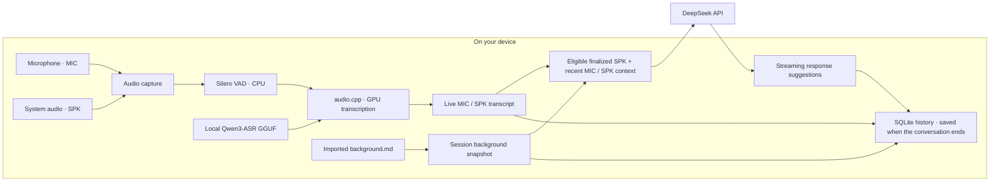

# Chunfe · 春风

[English](README.md) · [简体中文](README.zh-CN.md)

Chunfe is a Qt Quick desktop assistant for live conversations. It transcribes
microphone and system audio locally and uses DeepSeek to suggest responses to
questions, requests, and objections.

[Downloads](https://github.com/rangerzy/chunfe/releases) · [Build status](https://github.com/rangerzy/chunfe/actions/workflows/build.yml)

## Capabilities

- Live MIC and SPK transcripts in a floating panel, with pause, collapse, and drag controls.
- Streaming response suggestions based on the other person's finalized speech,
  recent conversation, and a background snapshot. MIC speech supplies context.
- UTF-8 Markdown background import, optional AI analysis, and a model test chat.
- Local conversation history with transcripts, suggestions, and background snapshots.

## Data flow



Speech recognition uses the local model. DeepSeek receives eligible SPK text,
recent confirmed MIC/SPK context, and the session's background snapshot.
Optional background AI analysis also sends the imported Markdown text to DeepSeek.
Model test chat sends the messages in that test session.

## Quick start

1. Download an installer from Releases or build the application below.
2. Choose microphone and system audio devices in **音频与转写** and grant audio permissions.
3. Select a compatible Qwen3-ASR GGUF file in **离线转写** and load the model.
   Obtain the GGUF separately and load it after each application restart.
4. For response suggestions, save a DeepSeek API key in **模型连接**.
   Optionally import a Markdown background file in **背景资料**.
5. Start a conversation from the home page. SPK appears on the left and MIC on the right.
   End the conversation to drain transcription and save its history.

The audio test and transcription test are separate from saved conversations.
Background imports accept `.md` and `.markdown` files up to 256 KiB.

## Platforms

| Platform | Audio capture | Local transcription runtime |
| --- | --- | --- |
| macOS arm64, 14.4+ | Microphone and system audio | Bundled Metal runtime |
| Windows x64 | Microphone and WASAPI loopback | Supply a verified Vulkan runtime externally |
| Linux x64 | Microphone | Supply a verified GPU runtime externally |

Windows and Linux transcription runtimes are supplied through the build option
`CHUNFE_AUDIOCPP_RUNTIME_DIR`. Those inference paths remain unvalidated here.
Conversation startup requires a loaded transcription engine. GPU initialization
must succeed. Linux system audio capture is currently unsupported.
Runtime packaging, device restrictions, and test details are documented separately.
[Audio capture](plugins/AudioPipline/README.md) · [Offline transcription](plugins/OfflineTranscription/README.md)

## Local data

Application data lives in `chunfeng` under the operating system's user configuration directory.
On macOS this is `~/Library/Preferences/chunfeng`.

| File | Contents |
| --- | --- |
| `config.ini` | API key, model selection, connection result, prompts, and last loaded GGUF path |
| `background.md` | Imported background document |
| `conversations.sqlite` | Saved transcripts, response suggestions, and background snapshots |

The API key is stored in plaintext in `config.ini`. Clearing the key field and
leaving it removes the saved key and its connection result.
Custom prompts in `[backgroundAnalysis]` and `[conversationAdvice]` require
`{{background}}`. Conversation advice also requires `{{context}}`.

## Build and test

Use Qt 6.12+ with Quick, Quick Controls, Multimedia, SVG, Network, and Sql,
a C++23 compiler, CMake 4.3.6+, and Ninja. Windows builds use Qt's matching MinGW toolchain.

```sh
cmake --preset relwithdebinfo \
  -DCMAKE_PREFIX_PATH="/path/to/Qt/6.12.0/platform" \
  -DCHUNFE_BUILD_TESTS=ON
cmake --build --preset relwithdebinfo
ctest --test-dir build/relwithdebinfo --output-on-failure --no-tests=error
python3 -B -m unittest discover -s tests -v
```

Run `build/relwithdebinfo/Chunfe.app/Contents/MacOS/Chunfe` on macOS,
or `build/relwithdebinfo/Chunfe` (`Chunfe.exe` on Windows).
Release presets are `macos-arm64-release`, `windows-x64-release`, and `linux-x64-release`.

## Further reading

- Audio devices, permissions, and PCM delivery. [AudioPipline](plugins/AudioPipline/README.md)
- Models, runtime deployment, and opt-in GPU tests. [OfflineTranscription](plugins/OfflineTranscription/README.md)
- Reusable presentation components. [UI controls](modules/ui_controls/README.md) · [Transcripts](modules/interview_transcript/README.md) · [Suggestions](modules/answer_panel/README.md) · [TextBlock](modules/text_block/README.md) · [Calendar](modules/calendar/README.md)
- Packaging entry points. [macOS](packaging/macos/package.sh) · [Windows](scripts/ci/package-windows.ps1) · [Linux Flatpak](packaging/linux/README.md)
- Version and release automation. [Version source](cmake/AppVersion.cmake) · [Version workflow](.github/workflows/version.yml) · [Build and release workflow](.github/workflows/build.yml)
- Third-party origins and licenses. [audio.cpp notices](plugins/OfflineTranscription/vendor/audio.cpp/ThirdPartyNotices.md) · [Fonts](resources/fonts/README.md) · [IconPark license](modules/ui_controls/icons/LICENSE)

macOS packages use ad hoc signing. Developer ID signing and Apple notarization
are pending, as is Windows code signing. Linux packages are distributed as standalone Flatpak files.
