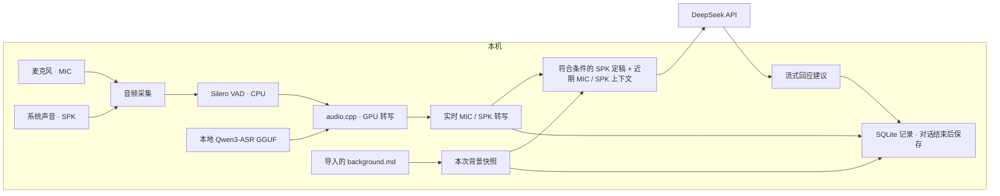

# 春风 · Chunfe

[English](README.md) · [简体中文](README.zh-CN.md)

春风是基于 Qt Quick 的桌面实时对话助手。它在本地转写麦克风和系统声音，
并使用 DeepSeek 为对方的问题、请求和异议提供回应建议。

[下载安装包](https://github.com/rangerzy/chunfe/releases) · [构建状态](https://github.com/rangerzy/chunfe/actions/workflows/build.yml)

## 主要功能

- 悬浮面板实时显示 MIC 和 SPK 转写，支持暂停、收起和拖动。
- 根据对方的定稿发言、近期对话和本次背景快照，流式生成回应建议。
  MIC 发言用于补充上下文。
- 导入 UTF-8 Markdown 背景资料，可选用 AI 分析和模型测试对话。
- 在本地保存对话转写、回应建议和背景快照，供后续查阅。

## 数据流



语音识别使用本地模型。DeepSeek 接收符合条件的 SPK 文字、近期已定稿的
MIC/SPK 上下文以及本次背景快照。
主动使用背景资料 AI 分析时，也会将导入的 Markdown 原文发送给 DeepSeek。
模型测试对话会发送本次测试会话中的消息。

## 快速开始

1. 从 Releases 下载安装包，或按下文构建应用。
2. 在**音频与转写**中选择麦克风和系统声音设备，并授予音频权限。
3. 在**离线转写**中选择兼容的 Qwen3-ASR GGUF 文件并加载模型。
   GGUF 文件需自行获取，每次重启应用后手动加载。
4. 如需回应建议，在**模型连接**中保存 DeepSeek API Key。
   可在**背景资料**中导入 Markdown 文件。
5. 从首页开始对话。左侧显示 SPK，右侧显示 MIC。
   结束对话后，应用等待转写收尾并保存记录。

收音测试和转写测试独立于保存的正式对话。
背景导入支持 `.md` 和 `.markdown`，文件上限为 256 KiB。

## 平台支持

| 平台 | 音频采集 | 本地转写运行库 |
| --- | --- | --- |
| macOS arm64，14.4+ | 麦克风和系统声音 | 内置 Metal 运行库 |
| Windows x64 | 麦克风和 WASAPI loopback | 需另外提供已验证的 Vulkan 运行库 |
| Linux x64 | 麦克风 | 需另外提供已验证的 GPU 运行库 |

Windows 和 Linux 的转写运行库通过构建选项 `CHUNFE_AUDIOCPP_RUNTIME_DIR` 提供。
这两条推理路径尚未在本项目中验证。
正式对话需要先加载转写引擎，GPU 初始化必须成功。
Linux 当前尚不支持系统声音采集。
运行库打包、设备限制和测试细节见专门说明。
[音频采集](plugins/AudioPipline/README.md) · [离线转写](plugins/OfflineTranscription/README.md)

## 本地数据

应用在操作系统的用户配置目录下使用 `chunfeng` 数据目录。
macOS 路径为 `~/Library/Preferences/chunfeng`。

| 文件 | 内容 |
| --- | --- |
| `config.ini` | API Key、所选模型、连接结果、提示词和上次加载的 GGUF 路径 |
| `background.md` | 导入的背景资料 |
| `conversations.sqlite` | 已保存的转写、回应建议和背景快照 |

API Key 以明文保存在 `config.ini`。清空 Key 输入框并离开后，
应用会移除已保存的 Key 和对应连接结果。
`[backgroundAnalysis]` 和 `[conversationAdvice]` 下的自定义提示词需要保留
`{{background}}`，回应建议还需要保留 `{{context}}`。

## 构建与测试

需要 Qt 6.12+，包含 Quick、Quick Controls、Multimedia、SVG、Network 和 Sql，
以及支持 C++23 的编译器、CMake 4.3.6+ 和 Ninja。Windows 使用 Qt 配套的 MinGW 工具链。

```sh
cmake --preset relwithdebinfo \
  -DCMAKE_PREFIX_PATH="/path/to/Qt/6.12.0/platform" \
  -DCHUNFE_BUILD_TESTS=ON
cmake --build --preset relwithdebinfo
ctest --test-dir build/relwithdebinfo --output-on-failure --no-tests=error
python3 -B -m unittest discover -s tests -v
```

macOS 运行 `build/relwithdebinfo/Chunfe.app/Contents/MacOS/Chunfe`，
其他平台运行 `build/relwithdebinfo/Chunfe`（Windows 为 `Chunfe.exe`）。
Release 预设为 `macos-arm64-release`、`windows-x64-release` 和 `linux-x64-release`。

## 详细说明

- 音频设备、权限与 PCM 交付。[AudioPipline](plugins/AudioPipline/README.md)
- 模型、运行库部署与可选 GPU 测试。[OfflineTranscription](plugins/OfflineTranscription/README.md)
- 可复用展示组件。[UI 控件](modules/ui_controls/README.md) · [转写面板](modules/interview_transcript/README.md) · [回应建议](modules/answer_panel/README.md) · [TextBlock](modules/text_block/README.md) · [Calendar](modules/calendar/README.md)
- 打包入口。[macOS](packaging/macos/package.sh) · [Windows](scripts/ci/package-windows.ps1) · [Linux Flatpak](packaging/linux/README.md)
- 版本与自动发布。[版本定义](cmake/AppVersion.cmake) · [版本工作流](.github/workflows/version.yml) · [构建与发布工作流](.github/workflows/build.yml)
- 第三方来源与许可证。[audio.cpp 声明](plugins/OfflineTranscription/vendor/audio.cpp/ThirdPartyNotices.md) · [字体](resources/fonts/README.md) · [IconPark 许可证](modules/ui_controls/icons/LICENSE)

macOS 安装包使用 ad hoc 签名，开发者证书签名和 Apple 公证尚待配置。
Windows 代码签名尚待配置。Linux 使用独立 Flatpak 文件分发。
